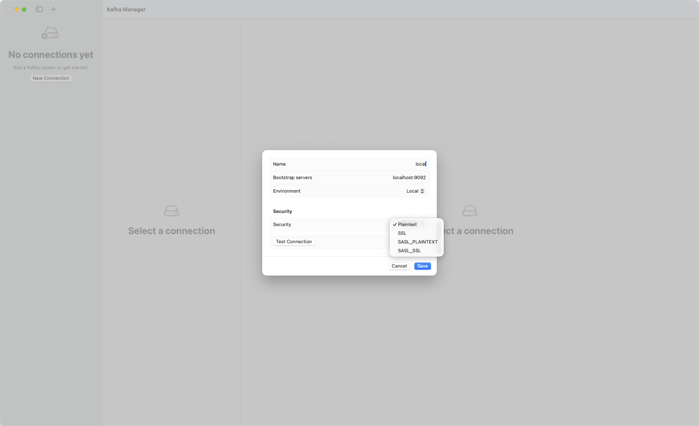

# Kafka Manager

A native macOS app for looking into Apache Kafka: browse topics and messages, send test messages, and inspect or reset
consumer groups, without a Java runtime or a command-line client.

- **Native.** Swift and SwiftUI, with the Kafka client (librdkafka) linked into the app. Nothing else to install.
- **Safe by default.** Clusters marked Production open read-only, and destructive actions ask you to retype a name.
- **Browsing never changes anything.** Reading messages does not join or commit to any consumer group.
- **Quiet.** No background polling; the app talks to a cluster only when you open it or press a button, and it
  disconnects after five idle minutes.
- **Your secrets stay on your Mac.** Passwords are kept in the macOS Keychain.

## Download and install

Download `KafkaManager-0.1.0-arm64.zip` from the Releases page of this repository, unzip it and move `KafkaManager.app`
to Applications.

- Requires macOS 14 or later on Apple Silicon.
- The release build is signed with a Developer ID and notarized by Apple.
- The first time you connect to a cluster with a saved password, macOS may ask whether Kafka Manager can use the
  Keychain item. Choose Always Allow.

## Quick start

1. Choose **File > New Connection** (Command-N), or press **New Connection** in the connection list.
2. Fill in **Name** and **Bootstrap servers** (for example `localhost:9092`), pick the **Environment**, and press
   **Test Connection**, then **Save**.

   

   The New Connection form on first launch.

3. Select the connection, then pick **Topics** in the segmented control. The app connects at this point.
4. Select a topic and open its **Messages** tab.
5. Leave **Start** on **Latest**, set a **Count**, and press **Fetch** (Command-Return).

## Guide

### Connections

A connection is a saved profile. The form has:

| Field | Notes |
|---|---|
| Name | Shown in the list and in the banner. |
| Bootstrap servers | Comma-separated `host:port` list, for example `host:9092, host2:9092`. |
| Environment | Local, Staging or Production. Shown as a banner in the cluster view. |
| Security | Plaintext, SSL, SASL_PLAINTEXT or SASL_SSL. |
| SASL mechanism | PLAIN, SCRAM-SHA-256 or SCRAM-SHA-512 (SASL only). |
| Username, Password | SASL only. The password is saved in the macOS Keychain; leave it empty to keep a saved one, or turn on **Remove saved password**. |

**Test Connection** connects once, reports how many brokers answered, writes nothing and disconnects. Use **Edit…**,
**Duplicate…** and **Delete…** in the list's context menu; deleting a Production connection asks you to type its name,
and removes its saved password from this Mac (the cluster itself is not changed).

For SSL, the app trusts the system certificate bundle at `/etc/ssl/cert.pem`. Client certificates are not supported.

The banner above the cluster view shows the cluster name, the environment and **Read-only** or **Read-write**. Its
button toggles the mode: **Make Read-only**, or **Allow Writes…** (on Production this asks for confirmation, and lasts
until you disconnect or switch back).

### Topics

Pick **Topics** to see the list: search with **Search topics** (Command-F), sort by name, partitions or replication
factor, and turn on **Show internal** to include internal topics. **Refresh** (Command-R) reloads.

A topic's detail has four tabs:

- **Partitions**: leader, replicas and in-sync replicas (ISR) per partition, plus start and end offset, message count and status.
- **Config**: the topic's settings; **Only non-default** hides the ones left at their default.
- **Messages**: see below.
- **Consumer Groups**: the groups that have committed offsets for this topic or have it assigned, with their state and lag on this topic.

**New Topic** creates a topic: **Name**, **Partitions**, **Replication factor** and an optional **Cleanup policy**.
**Delete Topic…** asks you to retype the topic name. Both are disabled when the cluster is read-only.

### Messages

Choose a **Partition** (or **All partitions**) and where to **Start**:

- **Latest** with a **Count**: the most recent messages (newest by timestamp when reading all partitions).
- **Earliest**: from the start of the log.
- **Offset**: from a given offset.
- **Timestamp**: from a date and time.

**Limit** (default 500, up to 10,000) is the maximum number of messages fetched. A fetch also stops at 64 MB of
messages. **Stop** ends it early; rows already received stay.

The table sorts by timestamp, newest first, by default; click a column header to change it. **Filter fetched
messages** searches the key and value text of the rows already fetched.

Selecting a row opens its detail: metadata, headers, key and value. The **Format** picker offers **Auto**, **JSON**,
**Text** and **Hex**; Auto shows JSON if the payload is valid JSON, text if it is valid text, and hex otherwise. **Wrap
lines** wraps long lines. The panel shows at most 64 KB of a payload; the copy buttons are not limited:

- **Copy Key (as shown)** and **Copy Value (as shown)** copy the whole part in the chosen format.
- **Copy Message** copies the whole message as JSON (topic, partition, offset, timestamp, key, value, headers).
- The row context menu has **Copy Raw Key** and **Copy Raw Value**, which copy the bytes as UTF-8 text (or base64 if
  they are not text) without formatting.

JSON is only formatted up to 32 MB; larger payloads are shown and copied as text.

### Produce

**Produce…** in the topic header opens the sheet. It sends one message (or the same message several times).

- **Partition**: Auto (the Kafka client's partitioner chooses) or a specific one.
- **Key**: Text or Hex; empty means no key.
- **Value**: Text, JSON or Hex. **Format** re-indents JSON. **Null (tombstone)** sends a null value, which is different
  from an empty one.
- **Headers**: **Add Header**, each with a name and a Text, Hex or Null value.
- **Set the timestamp**: otherwise the time of sending is used.
- **Times**: send the same message 1 to 1,000 times, with progress and **Stop**.

A message up to 1 MB is accepted. The sheet shows the size and any problem before you send. **Send** is Command-Return;
afterwards **Send Another** keeps the fields. On a Production cluster, **Send** asks you to retype the topic name. The
topic must already exist: producing never creates one.

**Produce Again…** (in the message detail and the row context menu) opens the sheet with that message's key, value and
headers filled in. The partition is set to Auto. After a send, the Messages tab shows **New message available** with
**Fetch again**; nothing is fetched automatically.

### Consumer groups

**Consumer Groups** lists the groups; search with **Search groups**. **Load lag** fills in the total lag, a few groups at a time. A
group's detail has **Lag** (per partition: committed offset, end offset, lag and the assigned member) and **Members** (client ID,
member ID, host and assigned partitions), plus an optional **Auto-refresh** with an **Interval**.

**Reset Offsets…** moves a group's committed offsets: **Skip to Latest (clear lag)**, **Rewind to Earliest**,
**To Time…** or **To Offset…**, for the whole group or selected topics. The sheet previews every partition (before,
after, lag change, and values clamped to the retained range). **Apply…** asks you to retype the group name, and
nothing is written before that. A reset is refused while the group has active members: stop its consumers first.

Only moving offsets is offered. Deleting a group is not, on purpose: a reset is reversible by resetting again, while a
delete discards the group's history.

### Safety model

- Production connections open read-only. Read-only blocks creating and deleting topics, producing and resetting
  offsets. **Allow Writes…** on Production needs a confirmation and ends when you disconnect.
- Retype-to-confirm: deleting a topic, deleting a Production connection, applying an offset reset, and sending to a
  Production cluster. The text must match exactly.
- Reading messages uses a separate consumer that only assigns partitions and never commits, so it cannot change any
  group's offsets and does not appear as a group member.
- Nothing is ever created as a side effect of reading (automatic topic creation is off).

## Privacy

- Connection profiles are stored in a SQLite file at `~/Library/Application Support/KafkaManager/kafkamanager.sqlite`.
- Passwords are stored only in the macOS Keychain (service `KafkaManager`), never in that file, logs or error messages.
- The app code contains no telemetry, analytics, crash reporting, update checker or other networking. The only network
  traffic is the Kafka protocol to the bootstrap servers and brokers you configured.

## Troubleshooting

These are the messages the app shows.

| Message | Likely cause and fix |
|---|---|
| Can't reach *host*. Check the address, your network, and that the broker is running. | Wrong host or port, broker down, VPN/firewall, or a security setting that does not match the listener (for example SSL or SASL selected for a plaintext port). Connection failures can take several seconds to appear. |
| Authentication failed. Check the username, password, SASL mechanism, and certificates. | Wrong credentials or mechanism, or a TLS handshake problem. |
| You don't have permission to access *resource*. | The user lacks ACLs for that topic or group. |
| Topic "*name*" doesn't exist. | The topic was deleted or the name is wrong; Refresh the list. |
| The cluster took too long to respond. Try again. | Slow or overloaded cluster, or a network problem. |
| "*name*" is read-only. Switch the cluster to a writable environment to make changes. | The cluster is read-only; use **Allow Writes…** in the banner. |
| The message is larger than the cluster accepts. | Shrink the message; the broker's limit is lower than the app's 1 MB. |
| Stop the group's consumers first; offsets can only be changed while the group has no active members. | Reset needs an empty group. |
| The cluster returned an error (code N). | Any other broker error; include the code when you report it. |

macOS may also ask whether Kafka Manager can use a Keychain item; choose Always Allow so saved passwords are read without asking each time.

## FAQ

**Does it change my consumer groups?** Browsing does not: it never commits or joins a group. Only **Reset Offsets…**
changes a group's committed offsets, after a preview and a typed confirmation.

**Can it delete data?** It can delete a topic (typed confirmation, blocked when read-only). It cannot delete messages
individually or delete groups.

**Can it break production?** Production opens read-only. Writes need an explicit switch, and each destructive action
needs a retyped name.

**Which Kafka versions work?** It has been tested against Apache Kafka 3.9 running locally. See Known limitations.

**Where are my passwords?** In the macOS Keychain, nowhere else.

**Does it need Java or the Kafka command-line tools?** No.

**Does it auto-refresh?** Only where you turn it on (a group's **Auto-refresh**). Nothing polls in the background.

**Does it send data anywhere?** No; see Privacy.

## Known limitations

- TLS and SASL connections have not yet been verified against real brokers; only plaintext against a local Kafka 3.9
  has been tested. Treat them as unverified.
- No Avro, Protobuf or Schema Registry support: payloads are shown as JSON, text or hex.
- No deleting consumer groups, no editing topic configuration, no partition-count changes.
- Apple Silicon only for now (no Intel build).
- Client certificates (mutual TLS) are not supported; SSL uses the system certificate bundle.
- Produce sends one message at a time (optionally repeated); there is no file or batch import.

## Report a problem

Open an issue on this repository's Issues page. Please include the app version, your macOS version, what you did, and
the exact error text the app showed. Do not include passwords or message contents you cannot share.

## For developers

Requirements: macOS 14+ to run; Xcode or a Swift 6 toolchain to build.

```sh
scripts/dev.sh deps    # build vendored static librdkafka + OpenSSL once (git-ignored vendor/)
scripts/dev.sh build   # compile        scripts/dev.sh test   # unit tests
scripts/dev.sh run     # launch         scripts/dev.sh itest  # integration tests against a broker
```

Without `vendor/` the app builds with demo data only. Dev environment variables:

| Variable | Effect |
|---|---|
| `KAFKAMANAGER_DEMO=1` | Every profile talks to a built-in fake cluster. |
| `KAFKAMANAGER_DEMO_TOPICS=N` | Number of demo topics (default 200, up to 20,000). |
| `KAFKAMANAGER_DEMO_MESSAGES=N` | Demo messages per partition (default 30, up to 5,000). |
| `KAFKAMANAGER_DATABASE=/path/file.sqlite` | Use another profile database. |

`scripts/dev.sh itest` needs a broker (default `localhost:9092`, override with `KM_ITEST_BOOTSTRAP`). The tests only
create and delete topics named `km-itest-*` and groups named `km-itest-g-*`.

`ARCHS=arm64 scripts/package.sh` builds `dist/KafkaManager.app` (ad-hoc signed; bundle id
`com.thtsolution.kafkamanager`). `scripts/sign-and-notarize.sh` needs the owner's Apple account and is not run by
development tooling. The app icon source is `resources/AppIcon-1024.png`.

Layers: `KafkaManagerCore` (models, client protocol, storage), `KafkaManagerKafka` (librdkafka client),
`KafkaManagerUI` (SwiftUI), `KafkaManagerApp` (executable). Design documents are in Vietnamese:
[docs/product.md](docs/product.md), [docs/features/](docs/features/README.md),
[docs/architecture.md](docs/architecture.md), [docs/development.md](docs/development.md),
[docs/performance-budget.md](docs/performance-budget.md), [docs/review-standard.md](docs/review-standard.md),
[AGENTS.md](AGENTS.md).
